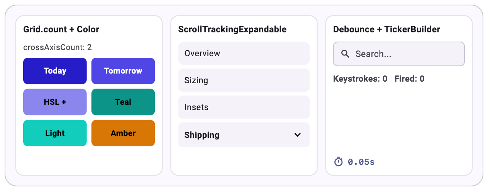

# fluiver

[![pub][pub-svg]][pub] [![points][points-svg]][score] [![CI][ci-svg]][ci]
[![license][license-svg]](LICENSE)

fluiver is a set of small widgets, extensions and helpers that the Flutter SDK
leaves out: a grid that doesn't scroll, debounce and throttle, an LRU cache,
date checks like `isToday`, and more. Nothing here duplicates
`package:collection`, `package:async` or `flutter_hooks`, and misuse throws
instead of quietly clamping.



## Quick start

```bash
flutter pub add fluiver
```

```dart
import 'package:fluiver/fluiver.dart';

Widget agenda(List<DateTime> meetings) {
  return ListView(
    children: [
      const Text('Meetings'),
      // GridView.count's layout without its own scrolling:
      // no shrinkWrap, no NeverScrollableScrollPhysics.
      Grid.count(
        crossAxisCount: 3,
        children: [
          for (final start in meetings)
            Text(start.isToday ? 'Today' : '${start.month}/${start.day}'),
        ],
      ),
    ],
  );
}
```

## What's inside

| Area | Highlights |
| --- | --- |
| [Widgets](doc/widgets.md) | `Grid`, `TickerBuilder`, `ScrollTrackingExpandable`, `ViewInsetsPadding`, `StatusBarHeader`, `StatusBarIcons`, `UnfocusOnTapOutside` |
| [Extensions](doc/extensions.md) | `Object.into`, `byNameOrNull`, `Map.where`/`entryOf`, `intersperse`, `slidingWindows`, `DateTime`/`TimeOfDay`, `Future.timeoutOrNull`, `Color` HSL/`contrastText`, `ScrollController`, `setTextAndCaret` |
| [Helpers](doc/helpers.md) | `Debounce`, `ThrottleFirst`/`Last`/`Latest`, `LatestOnly`, `LRUCache`, `DisposableBag`, `LocaleListener`/`BrightnessListener`, `NetworkProbe`, `FastHash`, `platformDispatch`, `TextFieldBuilders` |

## Guides

- [Widgets](doc/widgets.md) — non-scrolling `Grid`, `TickerBuilder`,
  `ScrollTrackingExpandable`, keyboard and status-bar insets, and
  `UnfocusOnTapOutside`.
- [Extensions](doc/extensions.md) — `Object.into`, iterable/map/enum
  gap-fillers, `DateTime` & `TimeOfDay`, `Future.timeoutOrNull`, `Color`
  transforms, `ScrollController`, and `TextEditingController`.
- [Helpers](doc/helpers.md) — `Debounce`/`Throttle*`, `LatestOnly`, `LRUCache`,
  `DisposableBag`, device listeners, and network/hashing/platform utilities.

## Agent skill

This package ships an agent skill in `skills/fluiver-usage/`, so coding agents
reach for these helpers instead of writing their own. Install it into your
project's agent config with:

```sh
dart run skills@ get --package fluiver --all
```

## Name

**flu**tter + [**quiver**](https://github.com/google/quiver-dart) — same spirit
as Google's archived Dart utility library, scoped to what Flutter apps need
today.

## Contributing

See [CONTRIBUTING.md](CONTRIBUTING.md).

## License

MIT — see [LICENSE](LICENSE).

[pub]: https://pub.dev/packages/fluiver
[pub-svg]: https://img.shields.io/pub/v/fluiver.svg
[score]: https://pub.dev/packages/fluiver/score
[points-svg]: https://img.shields.io/pub/points/fluiver
[ci]: https://github.com/esenmx/fluiver/actions/workflows/ci.yaml
[ci-svg]: https://github.com/esenmx/fluiver/actions/workflows/ci.yaml/badge.svg
[license-svg]: https://img.shields.io/badge/license-MIT-blue.svg
